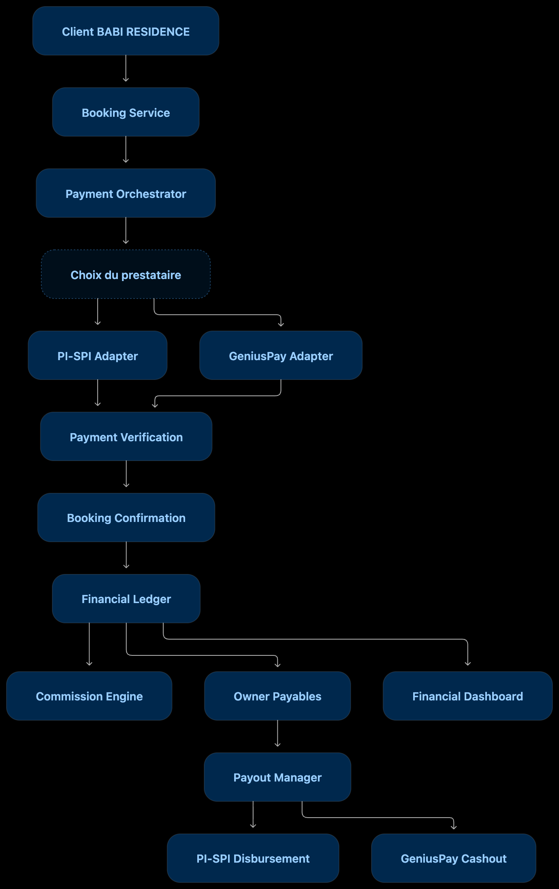

# Architecture

## Composants et fichiers

| Composant (spécification) | Réalisation | Rôle |
|---|---|---|
| Payment Orchestrator | `backend/services/paiement/PaymentService.js` | Démarre un paiement (QR, demande PI-SPI, page GeniusPay), suit son état, empêche les doubles paiements |
| Payment Integration Gateway (adaptateurs) | `services/paiement/PiSpiClient.js`, `GeniusPayClient.js`, registre `fournisseurs/` | Seuls fichiers qui connaissent les API des prestataires |
| Payment Verification | `PaymentService.verifier()` + webhooks (`server.js`) | Un paiement n'est « payé » qu'après relecture chez le prestataire (PI-SPI `IRREVOCABLE`, GeniusPay `completed` + montant) ; le navigateur ne confirme jamais rien |
| Financial Ledger | `services/finance/Ledger.js` | Registre en partie double, immuable, idempotent |
| Commission Engine | `services/finance/Commission.js` | Taux historisés, figés par réservation |
| Owner Payables | `services/finance/index.js` (`owner_payables`) | Sommes dues par réservation et par entreprise |
| Refund Management | `services/paiement/RefundService.js` + `Finance.remboursementEffectue()` | Remboursement selon la politique d'annulation, écriture comptable |
| Payout Management | `Finance.creerReversement()`, `agirReversement()` | Reversements manuels, en plusieurs étapes, avec preuve |
| Reconciliation | `services/finance/Rapprochement.js` | Détection des écarts |
| Financial Reporting | `Finance.apercu()`, `registre()`, export CSV | Tableau de bord |
| Interface | `client/src/pages/AdminFinancesPage.js` (plateforme), `AdminRevenusPage.js` (entreprise) | |

## Principe

1. Le client paie la **plateforme** (clés PI-SPI / GeniusPay de BABI RESIDENCE, variables d'environnement). Les entreprises n'ont plus de clés.
2. Le prestataire confirme ; le serveur relit l'état réel puis, **dans une même transaction MongoDB**, marque le paiement payé et écrit le registre : `FONDS_PRESTATAIRE` (débit) = `COMMISSION_BABI` + `DETTE_PROPRIETAIRE` (crédits).
3. La somme due à l'entreprise devient **versable 24 h après l'arrivée** prévue (14 h, heure d'Abidjan).
4. L'administrateur prépare, approuve, exécute (virement hors du site, référence saisie), joint la preuve et confirme le reversement.
5. Le rapprochement vérifie que le registre, les réservations et les prestataires concordent.

Les appels réseau aux prestataires ne sont jamais faits à l'intérieur d'une transaction MongoDB.
