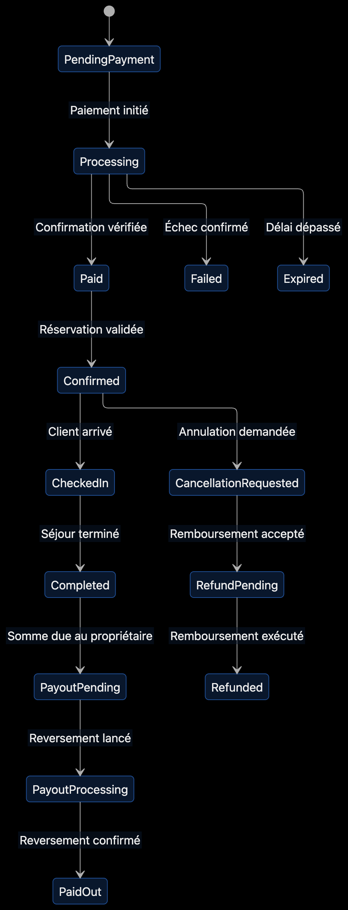

# Cycle de vie d'un paiement

Le statut de la **réservation** (`en_attente`, `confirmee`, `annulee`) est distinct de celui du **paiement** et de la **somme due**.

1. Réservation confirmée par l'entreprise → l'acompte devient payable.
2. Le client choisit **PI-SPI** (QR ou demande) ou **GeniusPay** (Mobile Money, carte). Pas de bascule automatique d'un prestataire à l'autre : un paiement en cours est réutilisé.
3. Paiement `en_attente` → le serveur relit l'état chez le prestataire (webhook, vérification périodique toutes les 20 s, ou ouverture de la page par le client).
4. Confirmé → **une transaction MongoDB** : paiement `paye` + écriture `PAIEMENT_CLIENT` + commission + somme due. Un second paiement pour la même échéance devient `doublon` (écriture `PAIEMENT_EN_DOUBLE`, à rendre).
5. Refusé / expiré → aucune écriture. Un paiement « expiré » reste vérifiable : s'il est finalement payé, il est confirmé.
6. Webhook absent : la vérification périodique interroge le prestataire avant de déclarer un échec.
7. Arrivée + 24 h → somme due **versable** → reversement manuel.

Clés d'idempotence : `PAIEMENT:<txId>`, `DOUBLON:<txId>`, `SURPLACE:<réservation>`, `REMBOURSEMENT:<acompte|solde>:<réservation>`, `REVERSEMENT:<id>`, `CONTRE:<transaction>`.
